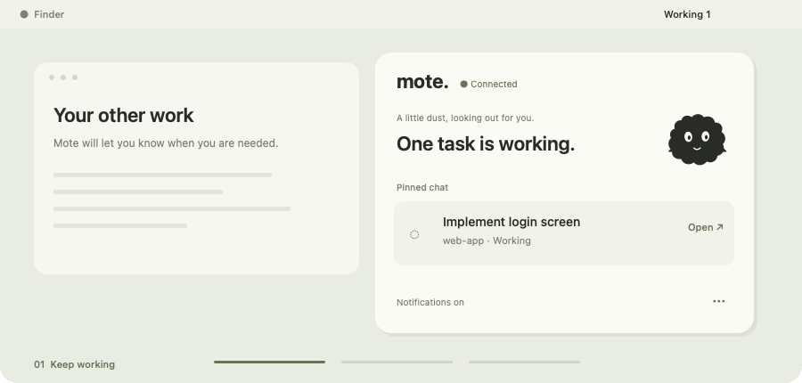

<div align="center">


# A little dust. A little less checking.

**When Codex needs you, Mote lets you know.**

<p>
<a href="https://github.com/shinhanseo/mote/releases/latest"></a>&nbsp;
<a href="https://shinhanseo.github.io/mote/en/"></a>&nbsp;
<a href="README.md"></a>
</p>

<p>
&nbsp;
&nbsp;

</p>

<br>



<sub>Illustrative animation with an example conversation.</sub>

[Try the interactive demo →](https://shinhanseo.github.io/mote/en/#demo)

</div>

<br>

### 01　Keep working. Stop checking.

See working sessions, approvals, questions, and unread replies at a glance.  
Watch several conversations and keep the ones you need pinned, even after they finish.

### 02　Right where you are.

Receive short alerts on the display you choose. Click to open the conversation.  
Snooze for ten minutes, or jump back with `Control+Option+Space`.

### 03　Your work stays on your Mac.

Local detection, with no Mote account or API key.  
Mote does not send code or conversations to its own server, approve actions, or reply for you.

<br>

---

### A little companion. Right in your menu bar.

**[Download the latest release ↓](https://github.com/shinhanseo/mote/releases/latest)**  
Open the DMG, move Mote to Applications, and launch it. Requires Codex Desktop.  
Developer ID signed · Apple notarized · Future updates install in the app.

<br>

<details>
<summary><b>Installation and updates</b></summary>

1. Download the DMG from the latest release.
2. Drag Mote to Applications, launch it, and allow notifications.
3. Work in Codex Desktop as usual.

On Mote 0.4.0+, choose **Check for updates and install** in Settings to download, install and relaunch. Users on 0.3.1 or earlier need one manual replacement. Do not run Mote from the mounted DMG.

</details>

<details>
<summary><b>Usage, notifications and privacy</b></summary>

Mote includes five-hour and weekly usage snapshots, reset estimates, threshold alerts, wait reminders, snooze, away summaries, last activity, and privacy mode. English and Korean are supported.

Usage comes from local records and can differ from actual limits. Reset alerts are estimates. Direct macOS Focus integration, other AI tools and iPhone pairing are not currently supported.

Update checks and installation contact GitHub Releases and the signed appcast on the Mote website. Codex's own AI service is separate. Detection relies on private, version-dependent Codex Desktop formats and may need compatibility fixes. Check Diagnostics or [report an issue](https://github.com/shinhanseo/mote/issues).

</details>

<details>
<summary><b>Build from source and technical notes</b></summary>

Requires macOS 14+ and Xcode command-line tools.

```sh
git clone https://github.com/shinhanseo/mote.git
cd mote
./build.sh
open Mote.app
```

Default local builds are ad-hoc signed, not notarized.

[Technical notes & tests](docs/DEVELOPMENT.md) · [Signing & distribution](DISTRIBUTION.md)

Regenerate the illustrative animation: `swift Tools/GenerateReadmeDemo.swift --english`

</details>

<br>

<div align="center">

<sub>[Releases](https://github.com/shinhanseo/mote/releases)　·　[Feedback](https://github.com/shinhanseo/mote/issues)　·　[Website](https://shinhanseo.github.io/mote/en/)</sub>

<br>

**A little dust, looking out for you.**

<sub>Independent app. Not affiliated with OpenAI.</sub>

</div>
