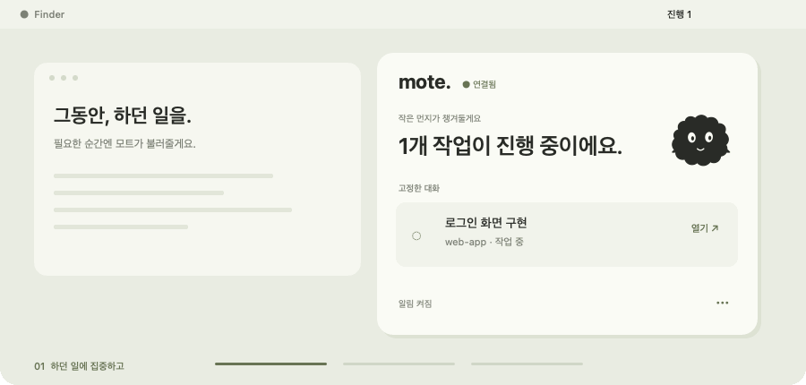

<div align="center">


<p>
<a href="https://github.com/shinhanseo/mote/releases/latest"></a>&nbsp;
<a href="https://shinhanseo.github.io/mote/"></a>&nbsp;
<a href="README.en.md"></a>
</p>

<p>
&nbsp;
&nbsp;

</p>

<br>

### Codex에 일을 맡기고, 당신은 하던 일을.

승인이나 답변이 필요할 때, 작업이 끝났을 때.  
작은 먼지의 움직임과 짧은 알림으로 알 수 있어요.

<br>



<sub>기능 설명용 애니메이션 · 예시 대화입니다.</sub>

[상태를 직접 눌러보고 싶다면 →](https://shinhanseo.github.io/mote/#demo)

</div>

<br>

### 01　계속 들여다보지 않아도.

작업 중, 승인 대기, 입력 필요, 미확인 답변을 구분해요.  
여러 대화를 함께 챙기고, 끝난 대화도 필요한 만큼 고정해 둘 수 있어요.

### 02　지금 쓰는 화면으로.

마우스가 있는 화면이나 원하는 모니터에서 알림을 받아요.  
누르면 그 대화로. 바쁘면 10분 뒤로. 키보드라면 `⌃⌥Space`로 돌아가세요.

### 03　당신의 작업은, 당신의 Mac에.

계정이나 추가 API 키 없이 로컬에서 감지해요.  
코드와 대화를 Mote 서버로 보내지 않고, 승인이나 답변을 대신하지 않아요.

<br>

---

### 작은 동료를 메뉴바에.

**[최신 버전 다운로드 ↓](https://github.com/shinhanseo/mote/releases/latest)**  
DMG를 열고 **응용 프로그램**으로 옮겨 실행하세요. Codex Desktop이 필요해요.  
Developer ID 서명 · Apple 공증 완료 · 다음 업데이트는 앱 안에서.

<br>

<details>
<summary><b>설치와 업데이트 안내</b></summary>

1. 최신 릴리스의 DMG를 내려받아요.
2. Mote를 응용 프로그램 폴더로 옮기고 실행해요.
3. 알림을 허용하고 Codex Desktop에서 평소처럼 작업하세요.

Mote 0.4.0 이상은 설정의 ‘업데이트 확인 및 설치’에서 다운로드·설치·재실행할 수 있어요. 0.3.1 이하는 한 번 수동 교체가 필요해요. DMG 안에서 직접 실행하지 마세요.

</details>

<details>
<summary><b>사용량, 알림, 개인정보에 관해</b></summary>

5시간·주간 사용량과 초기화 예정 시각, 한도 임계 알림, 대기 재알림, 스누즈, 부재 요약, 마지막 활동 표시를 지원해요. 개인정보 모드로 대화 제목과 프로젝트·요청 상세를 숨길 수 있어요. 한국어와 영어를 지원합니다.

사용량은 로컬 기록 기준이라 실제와 다를 수 있고, 초기화 알림은 예정 시각 안내예요. macOS 집중 모드 직접 연동과 iPhone 연동은 제공하지 않아요.

작업 감지는 로컬에서 이뤄지며, 업데이트 확인·설치는 GitHub 릴리스와 홈페이지의 서명된 업데이트 목록에 접속해요. Codex 자체의 AI 서비스 이용은 별개입니다.

Codex의 비공개 로컬 형식에 의존해 업데이트에 따라 대응이 필요할 수 있어요. 문제가 있으면 앱 진단 화면을 확인하거나 [이슈](https://github.com/shinhanseo/mote/issues)를 남겨주세요.

[전체 사용 안내](docs/GUIDE.ko.md)

</details>

<details>
<summary><b>소스 빌드와 기술 문서</b></summary>

macOS 14 이상, Xcode 명령줄 도구가 필요해요.

```sh
git clone https://github.com/shinhanseo/mote.git
cd mote
./build.sh
open Mote.app
```

기본 로컬 빌드는 임시 서명이며 공증된 공개 배포본과 달라요.

[개발·검증·기술 설명](docs/DEVELOPMENT.md) · [서명·공증·배포](DISTRIBUTION.md)

애니메이션은 기존 먼지 SVG로 생성합니다: `swift Tools/GenerateReadmeDemo.swift`

</details>

<br>

<div align="center">

<sub>[변경 내용](https://github.com/shinhanseo/mote/releases)　·　[피드백 보내기](https://github.com/shinhanseo/mote/issues)　·　[홈페이지](https://shinhanseo.github.io/mote/)</sub>

<br>

**작은 먼지가 챙겨둘게요.**

<sub>Independent app. Not affiliated with OpenAI.</sub>

</div>
