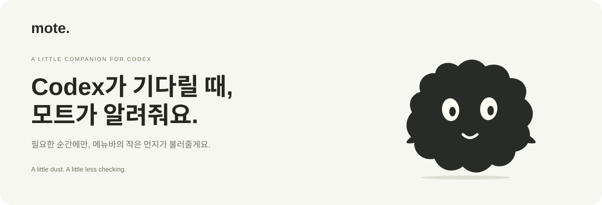

<div align="center">



**Codex에 일을 맡기고, 당신은 하던 일을 이어가세요.**  
작업 완료부터 승인·입력 대기까지, 메뉴바의 작은 먼지가 필요한 순간에 불러줘요.

[**Mac용 다운로드 ↓**](https://github.com/shinhanseo/mote/releases/latest)　·　[홈페이지 ↗](https://shinhanseo.github.io/mote/)　·　[English](README.en.md)


</div>

---

## 작은 먼지, 필요한 순간에만.

| 하던 일에 집중하고 | 필요한 순간을 알고 | 그 대화로 돌아가요 |
| :--- | :--- | :--- |
| Codex Desktop에 일을 맡기세요. | 먼지의 움직임과 짧은 알림으로 상태를 확인해요. | 알림이나 대화 카드를 눌러 Codex로 돌아가세요. |

**[홈페이지에서 상태·알림 데모 체험하기 →](https://shinhanseo.github.io/mote/#demo)**

## 모트가 챙기는 것들

| | 이런 순간에 도움이 돼요 |
| :--- | :--- |
| **승인·입력 대기 알림** | Codex가 내 결정을 기다리는 순간을 놓치지 않아요. 기다린 시간도 보여줘요. |
| **여러 대화를 한눈에** | 진행 중인 작업, 미확인 답변, 오류를 구분하고 필요한 대화는 고정해 둬요. |
| **지금 쓰는 화면으로** | 마우스가 있는 화면이나 원하는 모니터에서 짧은 알림을 받아요. |
| **바쁘면 조금 나중에** | 10분 스누즈, 대기 재알림, 자리 비운 사이의 미처리 작업 요약을 지원해요. |
| **키보드로 바로 이동** | `⌃⌥Space`로 가장 오래 기다린 대화를 열어요. 단축키는 변경하거나 끌 수 있어요. |
| **사용량은 필요할 때만** | 접힌 패널에서 5시간·주간 잔여량, 초기화 예정 시각과 한도 알림을 확인해요. |
| **연결과 마지막 활동** | 네트워크 끊김과 오래 변화 없는 상태를 표시해요. 작업 실패로 단정하지 않아요. |
| **화면 공유도 편안하게** | 개인정보 모드로 제목·프로젝트·요청 상세를 숨겨요. 한국어와 영어를 지원해요. |

사용량은 **로컬 기록 기준**이라 실제 잔여량과 다를 수 있어요. 초기화 알림은 예정 시각 안내이며, macOS 집중 모드와의 직접 연동은 제공하지 않아요.

## Mac에서 시작하기

1. **[최신 릴리스](https://github.com/shinhanseo/mote/releases/latest)**에서 `Mote-버전.dmg`를 내려받아요.
2. DMG를 열고 **Mote를 응용 프로그램 폴더**로 옮겨요.
3. Mote를 실행하고 알림을 허용한 뒤, Codex Desktop에서 평소처럼 작업하세요.

**macOS 14 이상 · Apple Silicon / Intel · Codex Desktop 필요**  
공개 배포본은 Developer ID 서명과 Apple 공증을 마쳤어요. 현재 무료로 사용할 수 있어요.

**다음 업데이트는 앱 안에서.** Mote 0.4.0 이상은 설정의 **‘업데이트 확인 및 설치’**에서 다운로드·설치·재실행까지 진행해요. 0.3.1 이하는 한 번 수동 교체가 필요해요. DMG 안에서 직접 실행하지 말고 응용 프로그램 폴더로 옮겨주세요.

## 당신의 작업은, 당신의 Mac에.

- **로컬에서 감지해요.** Codex의 로컬 기록과 실시간 상태를 읽으며, 코드와 대화를 Mote 서버로 보내지 않아요. Mote 계정이나 추가 API 키도 필요하지 않아요.
- **결정은 직접 해요.** 모트는 대화를 열어줄 뿐, 승인하거나 답변을 대신 보내지 않아요.
- **업데이트 연결은 별개예요.** 업데이트 확인·설치에는 GitHub 릴리스와 홈페이지의 서명된 업데이트 목록을 이용해요. Codex 자체의 AI 서비스 이용은 별개예요.

Codex Desktop의 비공개 로컬 형식에 의존하므로 Codex 업데이트에 따라 대응이 필요할 수 있어요. 감지가 이상하면 앱의 **진단 화면**을 확인하거나 [이슈](https://github.com/shinhanseo/mote/issues)를 남겨주세요. 다른 AI 도구와 iPhone 연동은 현재 제공하지 않아요.

## 직접 만들거나 더 알아보기

```sh
git clone https://github.com/shinhanseo/mote.git
cd mote
./build.sh
open Mote.app
```

소스 빌드에는 Xcode 명령줄 도구가 필요해요. 로컬 기본 빌드는 임시 서명이며, 공증된 공개 배포본과 다릅니다.

[개발·검증·기술 설명](docs/DEVELOPMENT.md) · [서명·공증·배포](DISTRIBUTION.md) · [변경 내용](https://github.com/shinhanseo/mote/releases) · [피드백](https://github.com/shinhanseo/mote/issues)

---

<div align="center">

**작은 먼지가 챙겨둘게요.**  
Independent app. Not affiliated with OpenAI.

</div>
